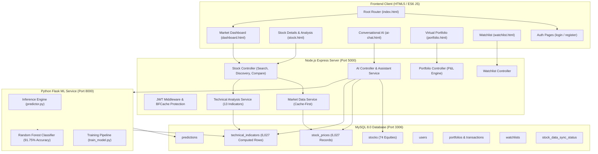

# StockSense — System Architecture

## Architecture Diagram

---

## Component Responsibilities

1. **Root Router & Auth**: Instant client-side redirect between unauthenticated login vs authenticated dashboard without exposing dashboard data.
2. **Catalog & Discovery**: High-performance multi-sector indexing, sector aggregations, real-time gainers/losers/volume calculations, and side-by-side comparative analytics.
3. **Indicator Engine**: Computes 13 technical indicators across rolling windows and persists them into MySQL.
4. **Random Forest Service**: Multi-stock ML classifier with 91.75% directional accuracy, outputting confidence scores and target prices.
5. **Conversational Assistant**: Context-aware natural language processor resolving user intents, executing multi-entity queries, supporting fluent Telugu and English, and maintaining conversation memory with dynamic suggested prompts.
